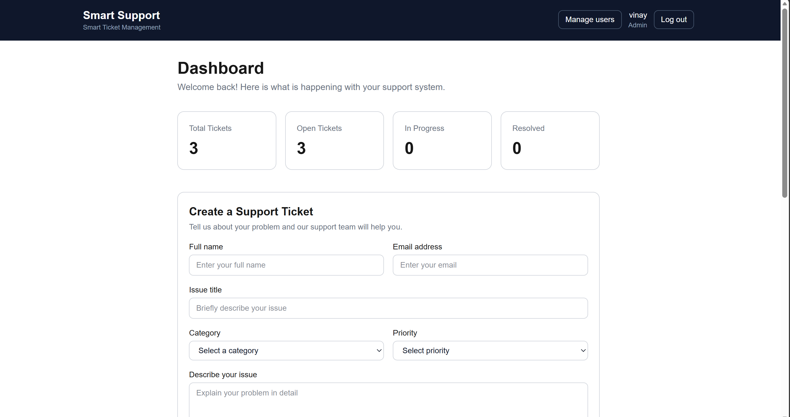
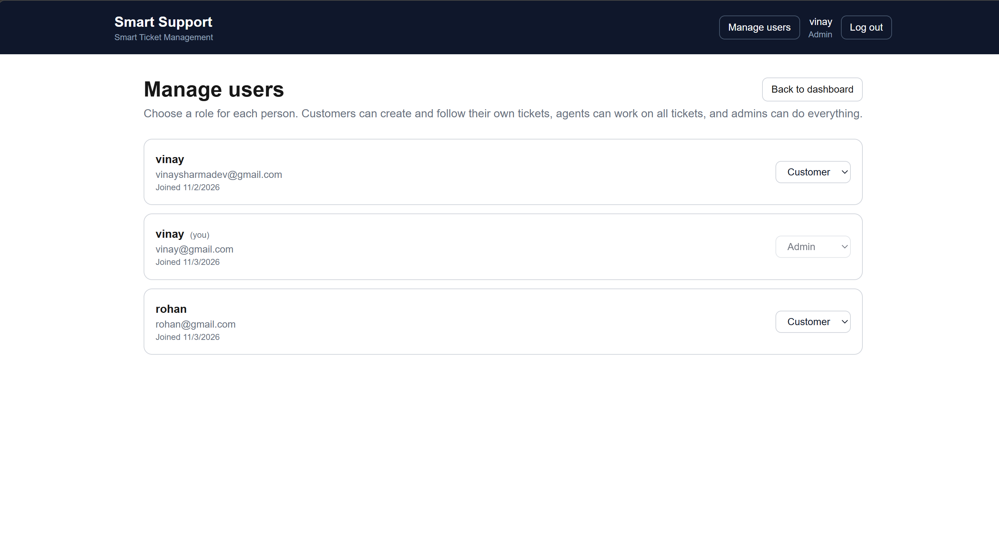
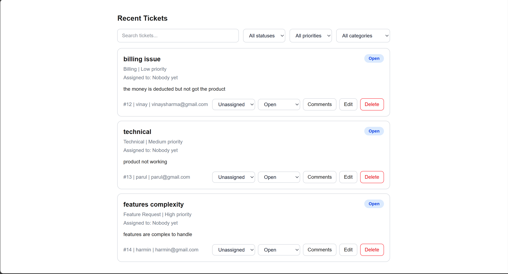
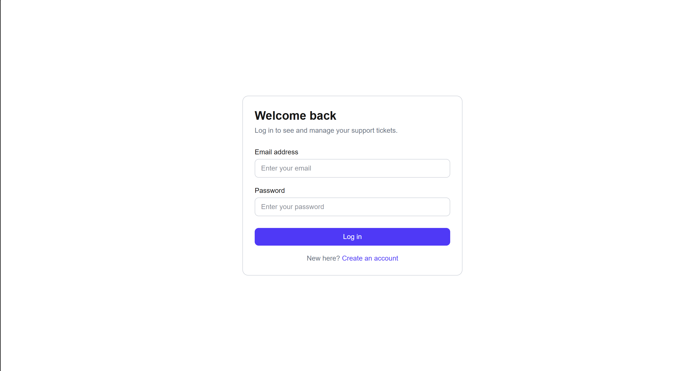

# Smart Support

A full-stack customer support and ticket management system. Customers raise support tickets, and support staff track, assign and answer them. Access is controlled by roles, and permissions are enforced on the server.

**Live demo:** https://smart-support-ten.vercel.app

## Screenshots

| Dashboard | Manage users |
| --- | --- |
|  |  |





## Features

- Create, edit and delete support tickets
- Search and filter tickets by status, priority and category
- Live stats cards (total, open, in progress, resolved)
- Assign tickets to agents and update their status
- Comment thread on every ticket
- Signup and login with secure sessions
- Three roles: **customer**, **agent** and **admin**
- Admin page to change user roles
- Responsive layout for phone, tablet and desktop
- Redirect to the login page when a session expires

## Roles

| Role | What they can do |
| --- | --- |
| Customer | Create tickets, see and edit only their own tickets, comment on them |
| Agent | See all tickets, assign tickets, change ticket status, comment |
| Admin | Everything an agent can do, plus delete tickets and manage user roles |

Every API route checks the logged-in user and their role on the server. Hiding a button in the interface is not treated as security.

## Tech Stack

- **Next.js 16** (App Router) and **React** for the frontend and API routes
- **TypeScript** for type safety
- **Tailwind CSS** for styling
- **PostgreSQL** hosted on **Neon**
- **Prisma** ORM with versioned migrations
- **Better Auth** for authentication and sessions
- **Zod** for input validation
- **Vercel** for hosting

## API Overview

| Method | Route | Purpose |
| --- | --- | --- |
| GET | `/api/tickets` | List tickets (customers see only their own) |
| POST | `/api/tickets` | Create a ticket |
| PUT | `/api/tickets/:id` | Update a ticket (status and assignee are staff only) |
| DELETE | `/api/tickets/:id` | Delete a ticket (admin only) |
| GET, POST | `/api/tickets/:id/comments` | Read and add comments |
| GET | `/api/agents` | List agents and admins (staff only) |
| GET | `/api/admin/users` | List users (admin only) |
| PUT | `/api/admin/users/:id` | Change a user's role (admin only) |

## Run Locally

1. Clone the repository and install the packages:

   ```bash
   git clone https://github.com/vinaysharma8571/smart-support.git
   cd smart-support
   npm install
   ```

2. Create a `.env` file in the project root:

   ```
   DATABASE_URL="your-postgresql-connection-string"
   BETTER_AUTH_SECRET="a-long-random-string"
   BETTER_AUTH_URL="http://localhost:3000"
   ```

3. Create the Prisma client, apply the migrations and add the sample tickets:

   ```bash
   npx prisma generate
   npx prisma migrate deploy
   npx prisma db seed
   ```

4. Start the app:

   ```bash
   npm run dev
   ```

5. Open http://localhost:3000 and create an account. New accounts are customers. To make yourself an admin, change the `role` value of your row in the `user` table to `admin`.

## What I Learned

- How a full-stack app connects the browser, the API and the database
- Why permissions must be checked on the server, not only hidden in the interface
- Designing a database with relations and changing it safely with migrations
- Deploying to Vercel with environment variables and a cloud database

## Roadmap

- AI features: automatic category and priority detection, ticket summaries and suggested replies
- Email notifications
- Automated tests